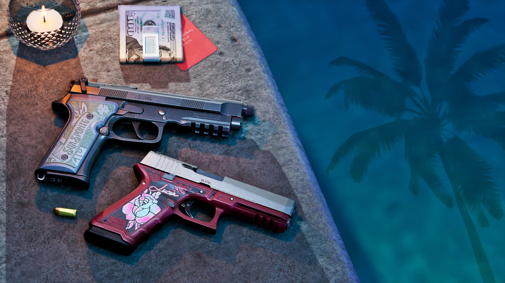

> **Información a 24 de octubre de 2026.** GTA VI sale el 19 de noviembre. Rockstar **no ha publicado
> ninguna lista de armas ni sus estadísticas** (daño, cadencia, alcance, precio). Esta guía solo
> incluye armas que aparecen en material oficial, y se ampliará cuando salga el juego.

## Armas con nombre oficial

Son las únicas que Rockstar ha nombrado, en la web del juego o dentro del propio juego:

| Arma | Tipo | Dónde se ha visto |
|---|---|---|
| [Revólveres Hawk & Little Morgan](/guia/armas/revolveres-hawk-little-morgan/) | Revólveres (pareja) | Ultimate Edition |
| [Girardi ES9](/guia/armas/pistolas-girardi-es9-klose-k17/) | Pistola (la de Jason) | Ultimate Edition |
| [Klose K17](/guia/armas/pistolas-girardi-es9-klose-k17/) | Pistola (la de Lucia) | Ultimate Edition |
| Moreland 850 | Escopeta de corredera | *An Extended Look* (el nombre aparece al recogerla) |

*Imagen: Rockstar Games*

## Armas vistas en material oficial (sin nombre)

Aparecen en tráilers, capturas o vídeos oficiales, pero Rockstar no ha dicho cómo se llaman:

**Pistolas y revólveres**
- Varias pistolas: la de Jason en el primer tráiler, la de Raul Bautista en una captura y otra en el
  maletero de un coche.
- Un revólver de gran calibre con el nombre *Mustang .357* grabado en el cañón (captura de Ambrosia).

**Subfusiles y rifles**
- Un subfusil compacto (segundo tráiler).
- Varios rifles de la marca **Duke**, cuyo nombre se lee en las capturas: una carabina, una versión de
  operaciones especiales y un rifle de francotirador. En *An Extended Look* Jason recoge un fusil de
  asalto Duke de un enemigo.

**Escopetas**
- Escopeta de corredera: Lucia la dispara con una sola mano en *An Extended Look*.
- Escopeta de dos cañones (captura de Grassrivers).

**Explosivos y armas pesadas**
- Lanzagranadas (segundo tráiler).
- Cóctel molotov: Lucia lo usa para quemar un coche de huida en *An Extended Look*.

**Cuerpo a cuerpo**
- Bate de béisbol, martillo, taco de billar y palo de minigolf.

## Lo que sabemos del arsenal

- **Munición:** se muestra como cargador + reserva. En el material oficial se ha visto una carabina con
  40/300 balas y una escopeta con 6/94.
- **Personalización:** existen acabados grabados para las pistolas de Jason y Lucia, un
  [acabado tropical](/guia/armas/acabado-tropical-vintage-vice-city/) del Pack Vintage Vice City
  y armas con mira telescópica. Todavía no se ha visto el menú para modificarlas.
- **Cuánto se puede llevar:** según las primeras impresiones de quienes vieron el juego, habrá
  un **límite de armas encima** (mucho menor que en GTA V) y el resto se guardará en el maletero o en
  el piso franco. Rockstar no lo ha detallado; lo confirmaremos cuando salga.

## Nombres que circulan pero NO están confirmados

En internet hay listas de más de 40 armas, pero muchas salen de la filtración de 2022, que Rockstar
nunca confirmó. Nombres como *Hunter Sniper*, *Heavy Machine Gun*, *RPG*, *Speargun* o los palos de golf
no aparecen en ningún material oficial. Si quieres seguirles la pista, están en la sección de
[filtraciones](/filtraciones/).

## Fuentes

- [GTA Intel: armas confirmadas con pruebas oficiales](https://gtaintel.com/news/gta-6-confirmed-weapons-list)
- [Sole Retriever: todo lo mostrado en An Extended Look](https://www.soleretriever.com/news/articles/grand-theft-auto-6-an-extended-look-breakdown-gameplay-reveal)
- [Kotaku: todo lo que incluye la Ultimate Edition](https://kotaku.com/exclusive-vehicles-guns-and-more-heres-everything-included-in-the-grand-theft-auto-6-ultimate-edition-2000709941)
- [GamesRadar: armas de GTA 6](https://www.gamesradar.com/games/grand-theft-auto/gta-6-weapons/)
