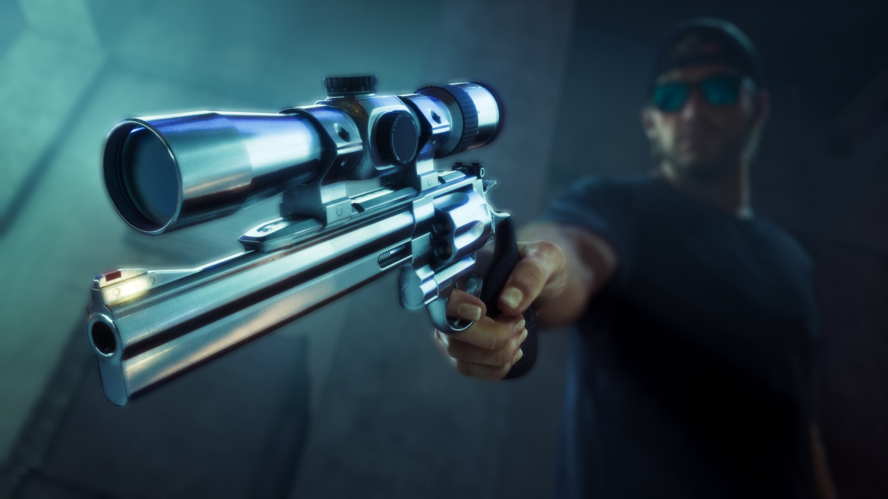

> **Información a 24 de octubre de 2026.** Las estadísticas (daño, alcance, cadencia) se añadirán
> cuando salga el juego.

## Ficha

| | |
|---|---|
| **Tipo** | Revólveres de gran calibre (pareja) |
| **Para** | Jason y Lucia, uno cada uno |
| **Cómo conseguirlos** | Incluidos en la **Ultimate Edition** |
| **Estadísticas** | Sin confirmar |

## Cómo son

Son dos revólveres a juego, pensados como «él y ella»:

- **El de Jason:** acero inoxidable, con **mira telescópica** y su nombre grabado.
- **El de Lucia:** acabado pavonado (oscuro), cañón largo, detalles dorados y su nombre grabado.

Los dos llevan empuñaduras decoradas con **palmeras**, muy en la estética de Vice City.

*Imagen: Rockstar Games*

## Fuentes

- [Kotaku: todo lo que incluye la Ultimate Edition](https://kotaku.com/exclusive-vehicles-guns-and-more-heres-everything-included-in-the-grand-theft-auto-6-ultimate-edition-2000709941)
- [GTA Intel: armas confirmadas con pruebas oficiales](https://gtaintel.com/news/gta-6-confirmed-weapons-list)
- [Rockstar Games: Media & Artwork](https://www.rockstargames.com/VI/media)
