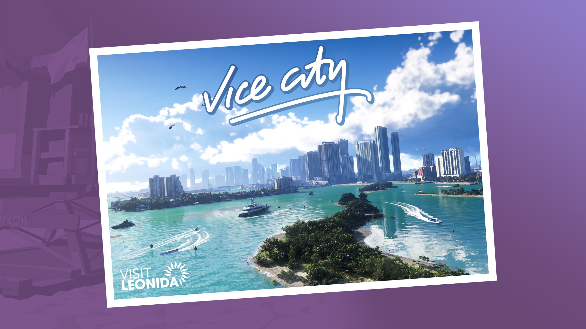
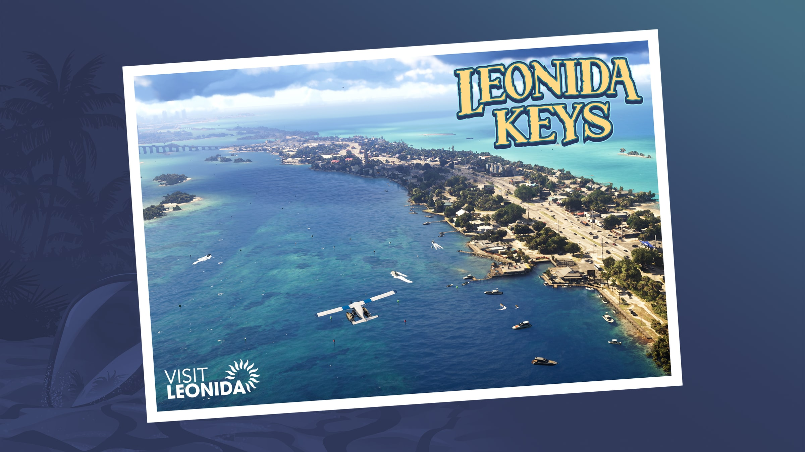
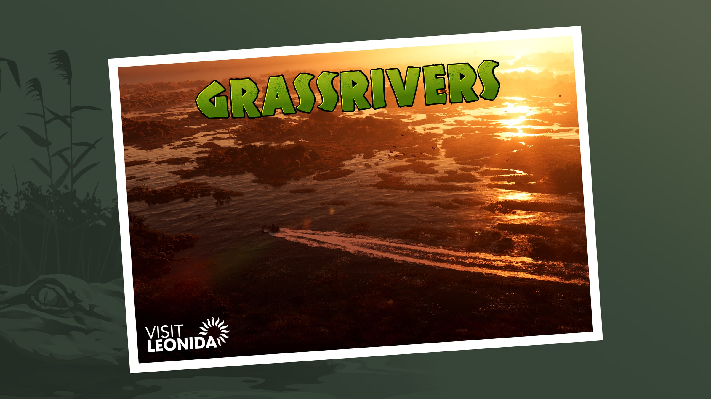
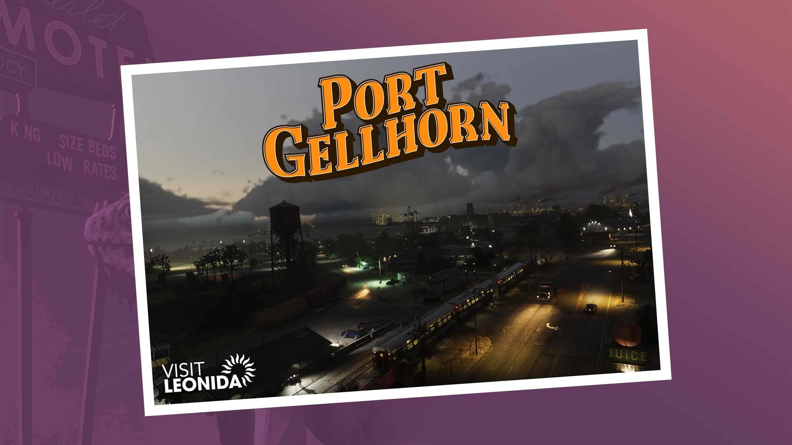
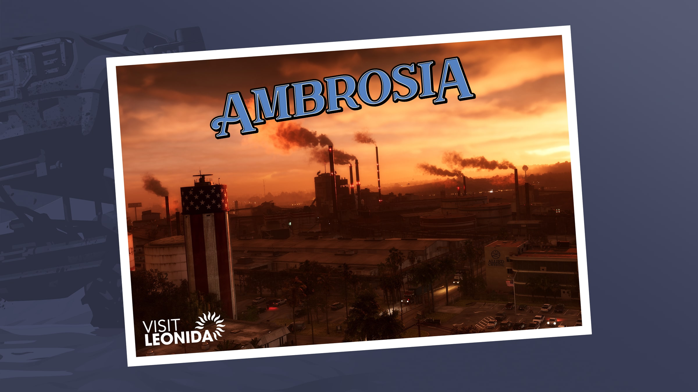
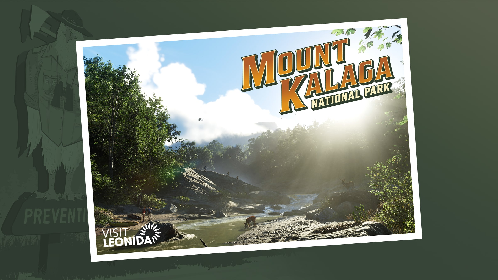

> **Información a 10 de noviembre de 2026.** Las seis regiones son las que Rockstar presenta en su web
> oficial. Las comparaciones con lugares reales son **de la comunidad**: Rockstar no las ha confirmado.
> Cuando salga el juego añadiremos el mapa completo y los puntos de interés.

GTA VI transcurre en **Leonida**, un estado ficticio inspirado en **Florida**, con una gran ciudad y
varias zonas naturales, industriales y costeras a su alrededor.

## Vice City

*Imagen: Rockstar Games*

La gran ciudad del juego, con sus calles de neón, playas y rascacielos. Es la versión de Rockstar de
**Miami**, la misma ciudad que inspiró GTA Vice City (2002), ahora en la actualidad.

## Leonida Keys

*Imagen: Rockstar Games*

Una cadena de islas unidas por puentes. Es la zona del pasado contrabandista de Brian Heder y donde
Jason trabajó para traficantes. *La comunidad la compara con los Cayos de Florida.*

## Grassrivers

*Imagen: Rockstar Games*

Una zona de **pantanos**; en las imágenes oficiales se ve el skyline de Vice City al fondo. *La comunidad la compara con los Everglades.*

## Port Gellhorn

*Imagen: Rockstar Games*

Una ciudad **portuaria**, según su propio nombre. *La comunidad la compara con la zona del
Panhandle de Florida.*

## Ambrosia

*Imagen: Rockstar Games*

Una zona **industrial**, a juzgar por las imágenes oficiales. *La comunidad la relaciona con las zonas
azucareras del interior de Florida.*

## Mount Kalaga

*Imagen: Rockstar Games*

Un **parque nacional** (así se llama en las postales oficiales: *Mount Kalaga National Park*), con
carreteras entre cañones y bosques. *La comunidad la compara con los bosques del norte de Florida.*

## Fuentes

- [Rockstar Games: personajes y lugares (Only in Leonida)](https://www.rockstargames.com/VI/only-in-leonida)
- [Rockstar Games: vídeos y arte de GTA VI (postales oficiales)](https://www.rockstargames.com/VI/media)
