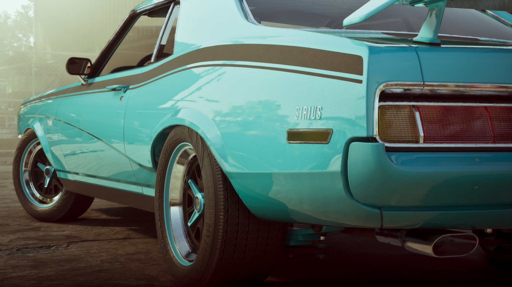
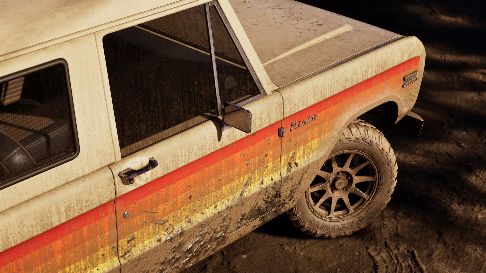
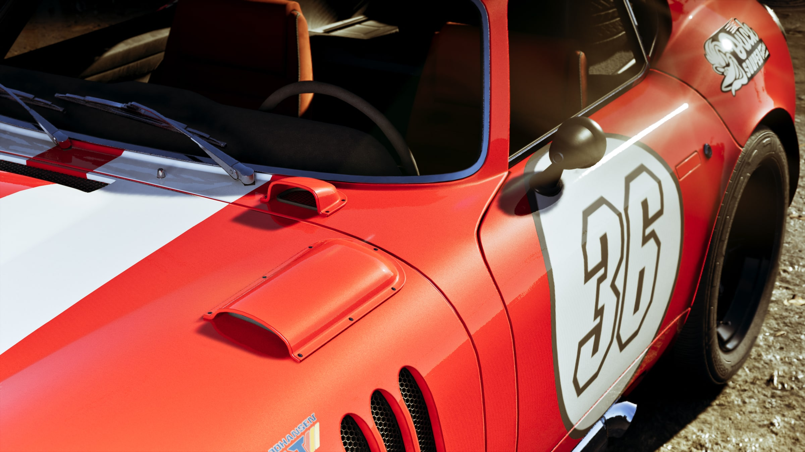
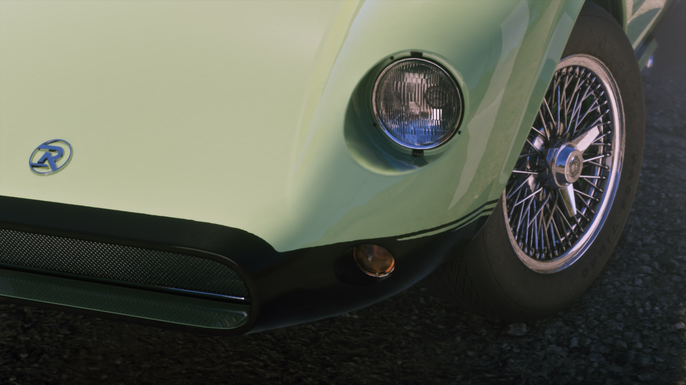
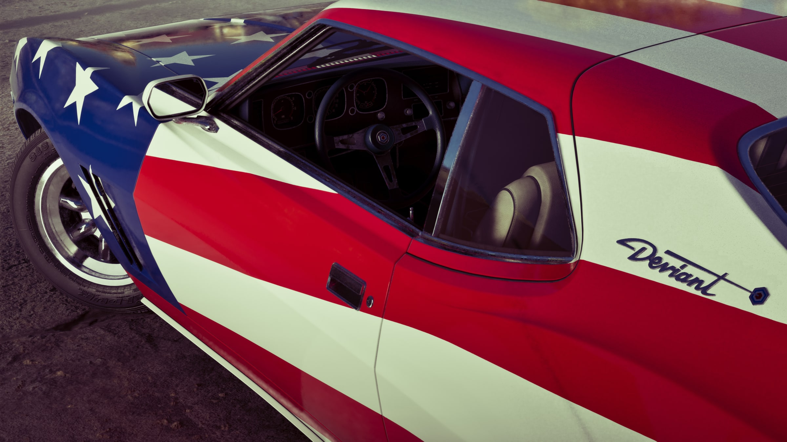

> **Información a 24 de octubre de 2026.** Rockstar no ha dicho todavía qué coches forman la colección.
> Completaremos la lista y sus ubicaciones cuando salga el juego.

## En qué consiste

Wyman es un coleccionista excéntrico que además hace de intermediario en Leonida. Su encargo
especial consiste en **localizar coches clásicos y proyectos abandonados** y **restaurarlos** para
él. Es contenido exclusivo de la **Ultimate Edition**.

## Los coches de las imágenes oficiales

Rockstar ha publicado imágenes de cinco coches de la colección sin decir oficialmente sus modelos.
En dos de ellos el nombre se lee en la carrocería: **Sirius** (el cupé turquesa) y **Deviant** (el
de la bandera de EE. UU.). Los otros son un todoterreno clásico con franjas, un deportivo de carreras
con el dorsal 36 y un clásico color crema con llantas de radios.

*Imagen: Rockstar Games*

*Imagen: Rockstar Games*

*Imagen: Rockstar Games*

*Imagen: Rockstar Games*

*Imagen: Rockstar Games*

## Fuentes

- [Kotaku: todo lo que incluye la Ultimate Edition](https://kotaku.com/exclusive-vehicles-guns-and-more-heres-everything-included-in-the-grand-theft-auto-6-ultimate-edition-2000709941)
- [GTABase: Wyman's Classic Car Collection](https://www.gtabase.com/side-missions/gta-6/wyman-s-classic-car-collection)
- [Rockstar Games: Media & Artwork](https://www.rockstargames.com/VI/media)
