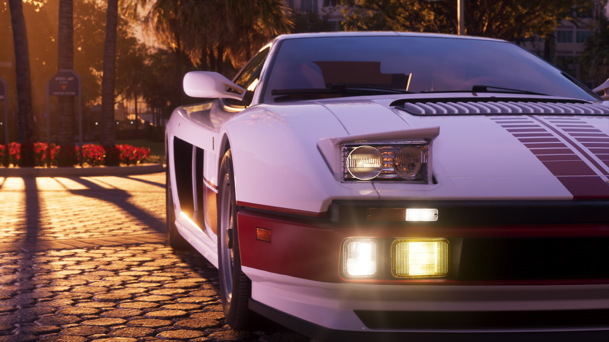
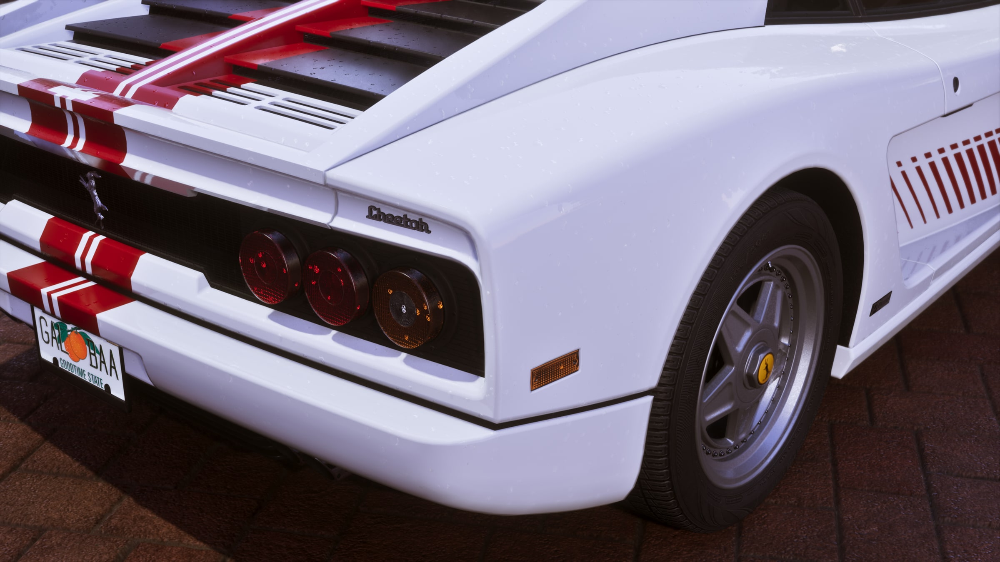
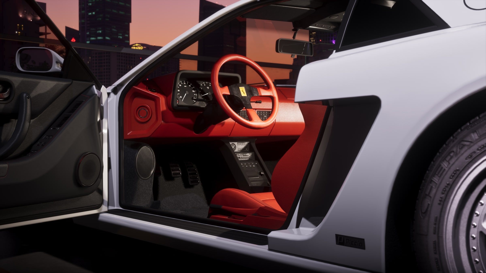

> **Información a 24 de octubre de 2026.** Las estadísticas (velocidad, aceleración, frenada) se
> añadirán cuando salga el juego el 19 de noviembre.

## Ficha

| | |
|---|---|
| **Tipo** | Deportivo |
| **Marca** | Grotti |
| **Año** | 1995 |
| **Cómo conseguirlo** | Incluido en la **Ultimate Edition** |
| **Estadísticas** | Sin confirmar |

## Cómo es

El Cheetah es un clásico de la saga y en GTA VI llega en una versión de mediados de los 90. Es un
deportivo de líneas rectas con faros escamoteables, inspirado en los superdeportivos italianos de la
época. Rockstar lo presenta con una pintura blanca de estilo retrofuturista y minimalista, con franjas
rojas, e interior en rojo.

*Imagen: Rockstar Games*

*Imagen: Rockstar Games*

*Imagen: Rockstar Games*

## Cómo conseguirlo

Forma parte de los extras de la Ultimate Edition (99,99 $ en EE. UU.). Rockstar ha indicado que el
contenido de esta edición se desbloquea a medida que avanzas en la historia, así que puede que no
esté disponible desde el primer minuto. Quien tenga la edición estándar podrá comprar la mejora a
Ultimate más adelante.

## Fuentes

- [Kotaku: todo lo que incluye la Ultimate Edition](https://kotaku.com/exclusive-vehicles-guns-and-more-heres-everything-included-in-the-grand-theft-auto-6-ultimate-edition-2000709941)
- [Rockstar Games: Media & Artwork](https://www.rockstargames.com/VI/media)
