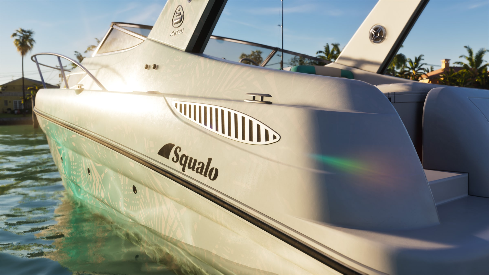
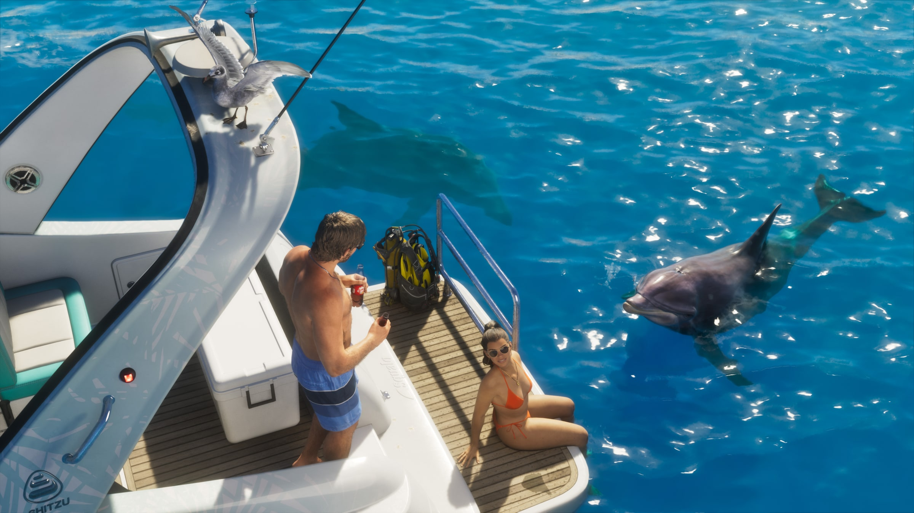
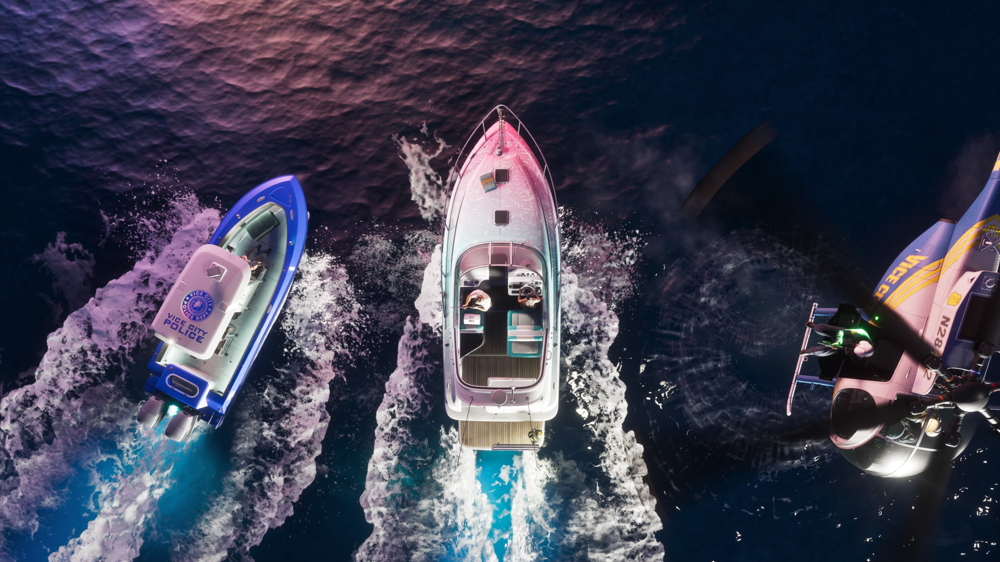

> **Información a 24 de octubre de 2026.** Las estadísticas se añadirán cuando salga el juego.

## Ficha

| | |
|---|---|
| **Tipo** | Lancha |
| **Marca** | Shitzu |
| **Dónde está** | Amarrada en **Washington Beach** |
| **Extra** | Caja de explosivos a bordo |
| **Cómo conseguirla** | Incluida en la **Ultimate Edition** |
| **Estadísticas** | Sin confirmar |

## Cómo es

Una lancha deportiva con colores rosa y azul, muy en la línea de Vice City. Rockstar la muestra
recorriendo la bahía con el skyline de fondo, en mar abierto y como base para bucear.

*Imagen: Rockstar Games*

*Imagen: Rockstar Games*

*Imagen: Rockstar Games*

## Fuentes

- [Kotaku: todo lo que incluye la Ultimate Edition](https://kotaku.com/exclusive-vehicles-guns-and-more-heres-everything-included-in-the-grand-theft-auto-6-ultimate-edition-2000709941)
- [Rockstar Games: Media & Artwork](https://www.rockstargames.com/VI/media)
