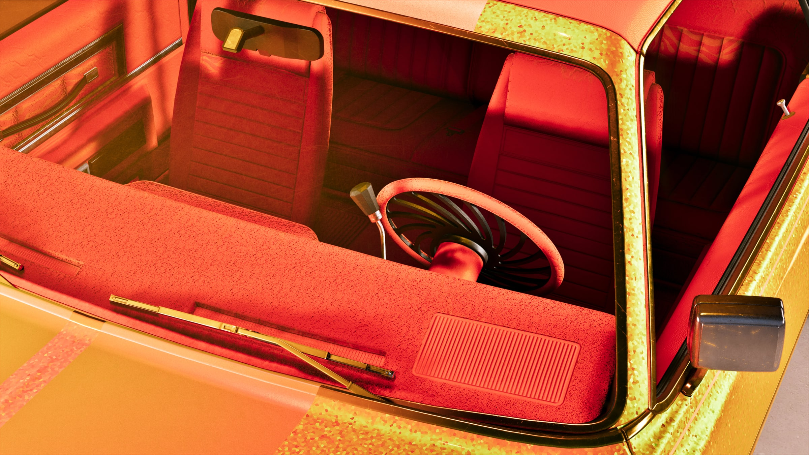
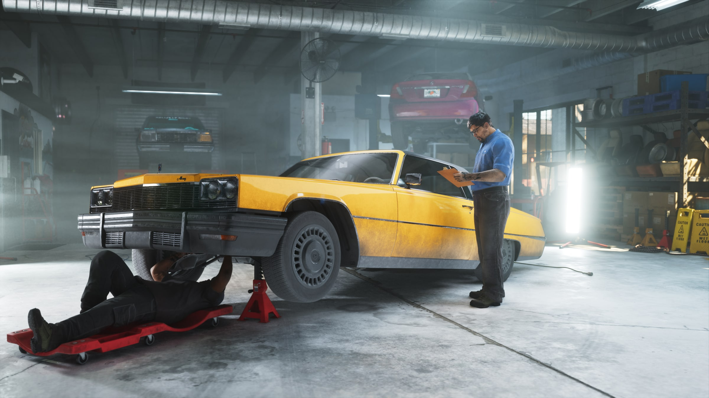
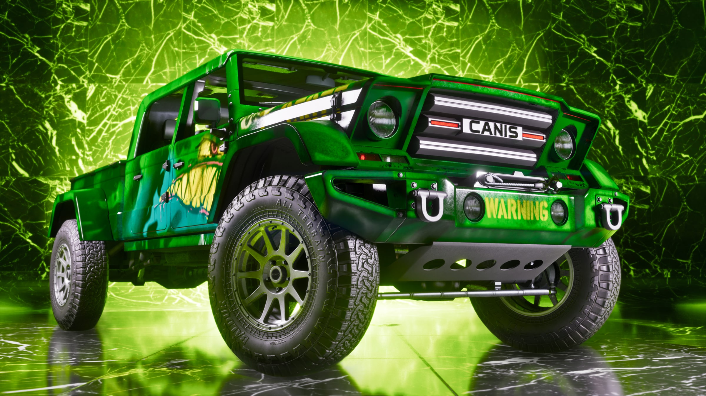
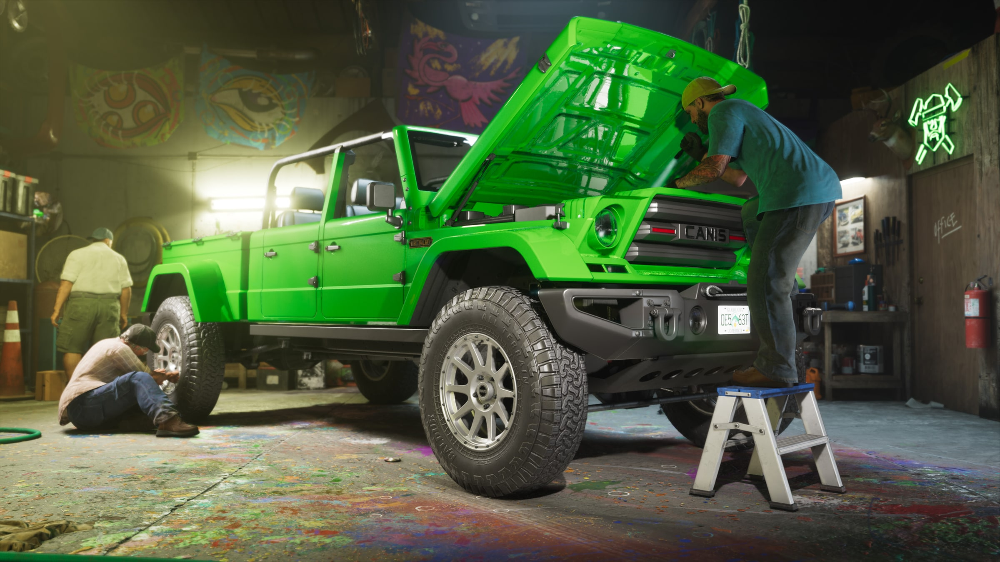

> **Información a 24 de octubre de 2026.** Rockstar aún no ha mostrado el menú de tuneo.
> Añadiremos las opciones y los precios cuando salga el juego.

Lo que sí está confirmado es que en GTA VI las mejoras **cambian el rendimiento y el manejo**,
no solo el aspecto. La Ultimate Edition añade dos talleres exclusivos.

## Rideout Customs

| | |
|---|---|
| **Especialidad** | Interiores detallados, llantas y estilo *donk* (coches clásicos muy elevados con llantas enormes) |
| **Disponible** | Solo con la **Ultimate Edition** |

*Imagen: Rockstar Games*

*Imagen: Rockstar Games*

## One-Eyed Willie's

| | |
|---|---|
| **Especialidad** | Modificaciones todoterreno y pinturas hechas a mano |
| **Dónde está** | Lake Leonida |
| **Disponible** | Solo con la **Ultimate Edition** |

*Imagen: Rockstar Games*

*Imagen: Rockstar Games*

## Fuentes

- [Kotaku: todo lo que incluye la Ultimate Edition](https://kotaku.com/exclusive-vehicles-guns-and-more-heres-everything-included-in-the-grand-theft-auto-6-ultimate-edition-2000709941)
- [Rockstar Games: Media & Artwork](https://www.rockstargames.com/VI/media)
