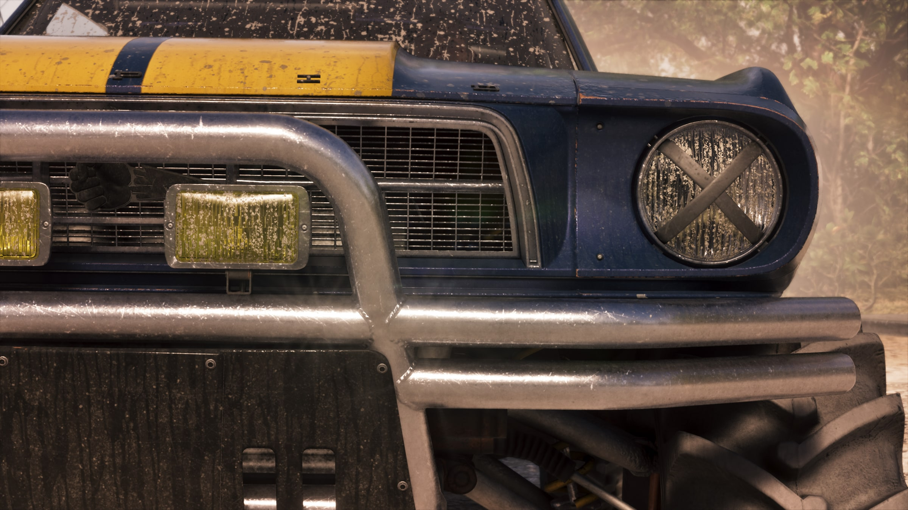
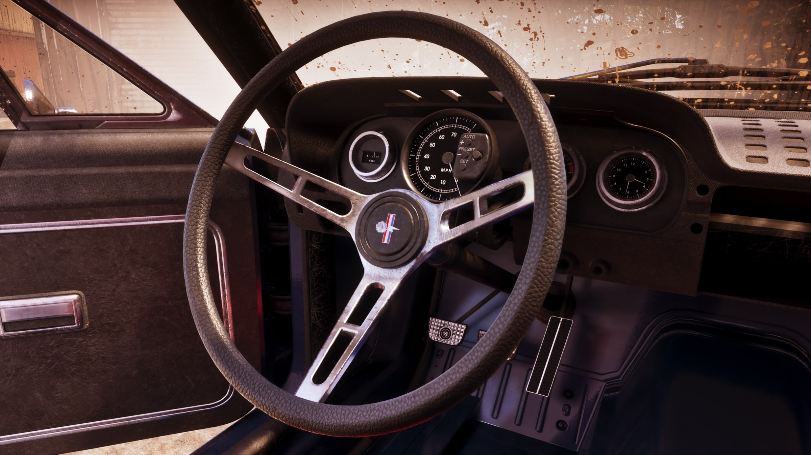
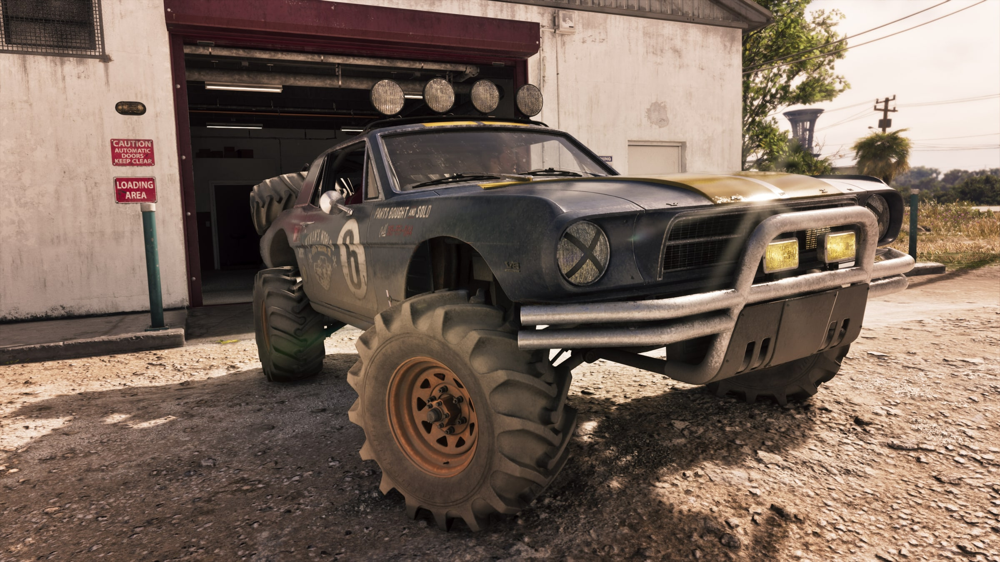

> **Información a 24 de octubre de 2026.** Las estadísticas se añadirán cuando salga el juego.

## Ficha

| | |
|---|---|
| **Tipo** | Buggy todoterreno |
| **Marca** | Vapid |
| **Año** | 1967 |
| **Cómo conseguirlo** | Incluido en la **Ultimate Edition** |
| **Incluye** | Paradise Garage en Watson Bay |
| **Estadísticas** | Sin confirmar |

## Cómo es

Es un Vapid Dominator clásico, el muscle car de la saga, transformado en buggy para el campo:
suspensión elevada, ruedas de tacos, defensa delantera y faros auxiliares. Ideal para los pantanos
y caminos de tierra de Leonida.

*Imagen: Rockstar Games*

*Imagen: Rockstar Games*

## El Paradise Garage

El buggy viene acompañado de un garaje propio en **Watson Bay**, el Paradise Garage. Según la
descripción de la Ultimate Edition, tiene **taquilla de armas** y un espacio para **guardar mercancía
robada** y venderla después.

*Imagen: Rockstar Games*

## Fuentes

- [Kotaku: todo lo que incluye la Ultimate Edition](https://kotaku.com/exclusive-vehicles-guns-and-more-heres-everything-included-in-the-grand-theft-auto-6-ultimate-edition-2000709941)
- [Rockstar Games: Media & Artwork](https://www.rockstargames.com/VI/media)
