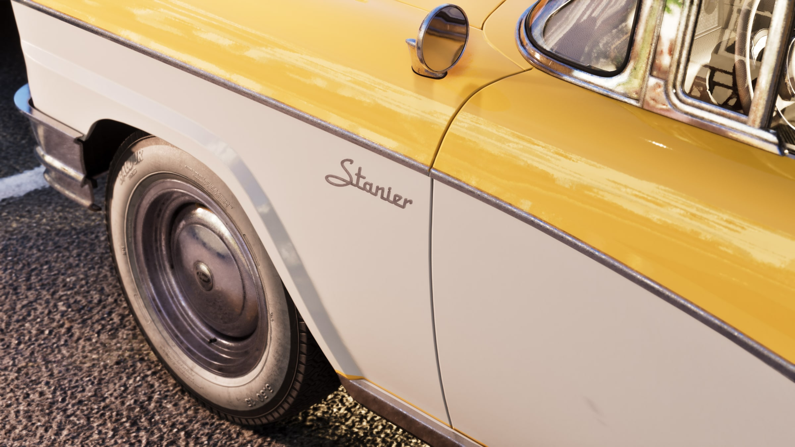
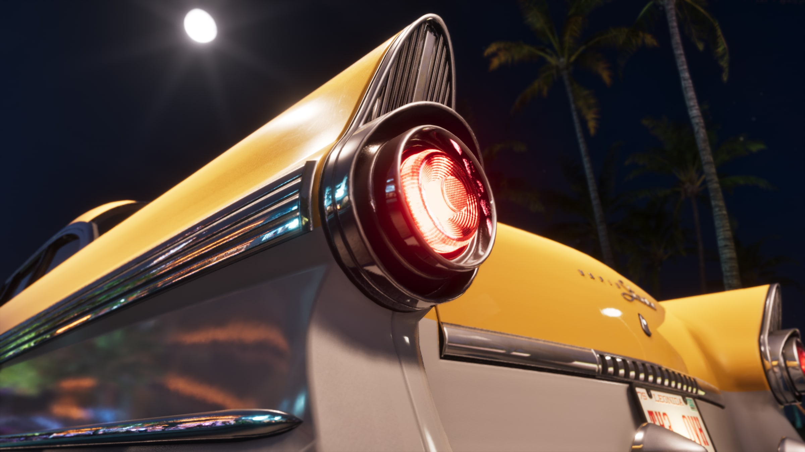

> **Información a 24 de octubre de 2026.** Las estadísticas se añadirán cuando salga el juego.

## Ficha

| | |
|---|---|
| **Tipo** | Coche clásico |
| **Marca** | Vapid |
| **Año** | 1955 |
| **Cómo conseguirlo** | **Pack Vintage Vice City**, bonificación por reservar el juego |
| **Estadísticas** | Sin confirmar |

## Cómo es

Un sedán clásico de los años 50 en amarillo y blanco, con cromados y aletas traseras. Es la pieza
central del pack de reserva, que rinde homenaje a la estética del Vice City original.

*Imagen: Rockstar Games*

*Imagen: Rockstar Games*

*Imagen: Rockstar Games*

## Qué incluye el Pack Vintage Vice City

- El **Vapid Stanier del 55**.
- El **garaje Shore Court**, cerca de Ocean Beach, con taquilla de armas y espacio para guardar
  mercancía robada y venderla.
- Ropa y peinados de inspiración retro para Jason y Lucia.
- Un [acabado tropical para armas](/guia/armas/acabado-tropical-vintage-vice-city/) inspirado en la
  camisa de Tommy Vercetti.

Se incluye al reservar el juego en formato digital, tanto en la edición estándar como en la Ultimate.

## Fuentes

- [Beebom: Pack Vintage Vice City](https://beebom.com/gta-6-vintage-vice-city-pack-pre-order-bonus-guide/)
- [Sportskeeda: Vintage Vice City Pack](https://www.sportskeeda.com/gta/vintage-vice-city-pack-gta-6-how-get)
- [Rockstar Games: Media & Artwork](https://www.rockstargames.com/VI/media)
