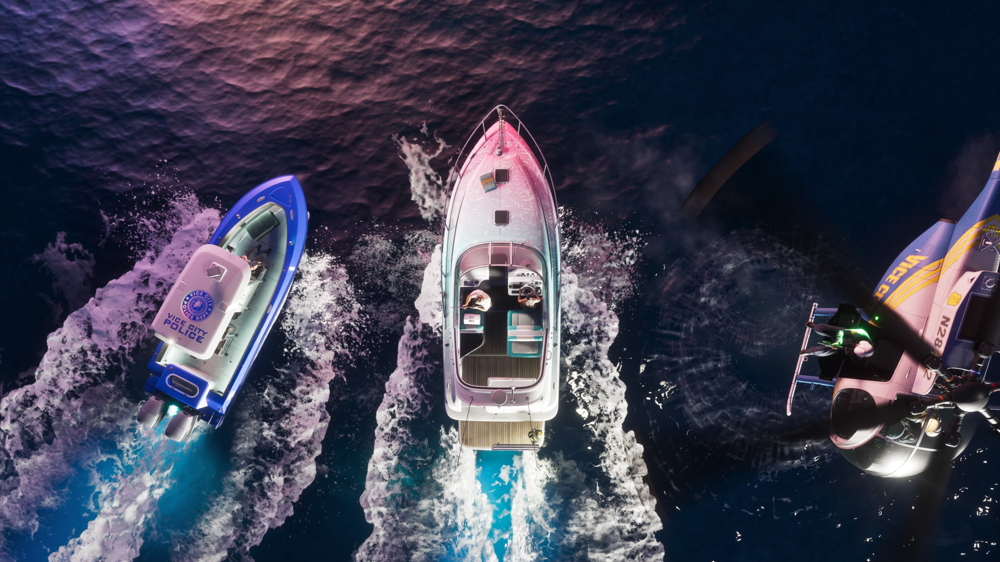
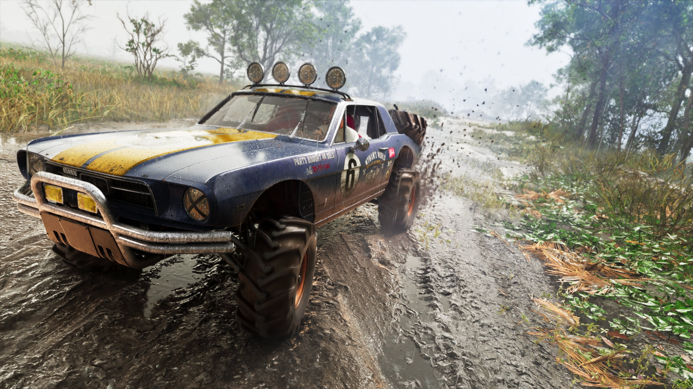

> **Información a 24 de octubre de 2026.** GTA VI sale el 19 de noviembre. Rockstar **no ha publicado
> ninguna lista oficial de vehículos** ni cuántos habrá. Esta guía recoge lo que está confirmado y se
> ampliará con estadísticas y ubicaciones en cuanto el juego esté disponible.

## Vehículos con nombre oficial

Estos son los únicos vehículos que Rockstar ha nombrado en su propio material. Todos llegan como
contenido extra de la **Ultimate Edition** o de la reserva del juego:

| Vehículo | Tipo | Cómo se consigue |
|---|---|---|
| [Grotti Cheetah del 95](/guia/vehiculos/grotti-cheetah-95/) | Deportivo | Ultimate Edition |
| [Vapid Dominator Buggy del 67](/guia/vehiculos/vapid-dominator-buggy-67/) | Buggy todoterreno | Ultimate Edition |
| [Shitzu Squalo](/guia/vehiculos/shitzu-squalo/) | Lancha | Ultimate Edition |
| [Dinka Enduro y Crest Kayak](/guia/vehiculos/vehiculos-piso-franco/) | Moto y kayak | Ultimate Edition |
| [Vapid Ganado (mejoras retro)](/guia/vehiculos/vapid-ganado-retro-build/) | Pickup de Jason | Ultimate Edition |
| [Vapid Stanier del 55](/guia/vehiculos/vapid-stanier-55/) | Clásico | Pack Vintage Vice City (reserva) |

Además, la Ultimate Edition incluye el encargo de [restaurar la colección de clásicos de Wyman](/guia/vehiculos/coleccion-clasicos-wyman/)
y dos [talleres de personalización](/guia/vehiculos/talleres-de-personalizacion/) exclusivos.

*Imagen: Rockstar Games*

## Vehículos vistos en tráilers e imágenes oficiales

La comunidad ha identificado **más de 150 coches** en los tráilers, las capturas oficiales y el vídeo
*An Extended Look*. Rockstar no les ha puesto nombre: se reconocen por su diseño o por el logotipo,
y muchos son modelos que vuelven de juegos anteriores de la saga. Los más claros:

- **Deportivos y superdeportivos:** Pegassi Zorrusso, Grotti Furia, Pfister Comet.
- **Muscle cars:** varias versiones del Vapid Dominator, Bravado Buffalo STX.
- **Furgonetas y camiones:** Declasse Burrito, Vapid Speedo, camiones de caja y tráileres.
- **Motos:** motos de campo (Maibatsu Sanchez y Manchez en las pruebas de motocross), deportivas y choppers.
- **Agua:** motos acuáticas, lanchas, kayaks y **aerodeslizadores** (airboats) en los pantanos.
- **Aire:** helicópteros, incluidos los de la policía en las persecuciones.
- **Otros:** quads, patinetes eléctricos y bicicletas.

> Estos nombres los ha puesto la comunidad, no Rockstar. Pueden cambiar cuando salga el juego.

*Imagen: Rockstar Games*

## Lo que sabemos de la conducción

Según lo mostrado en *An Extended Look* y lo publicado por Rockstar:

- **Manejo:** Rockstar ha contado con pilotos de carreras reales para ajustar la conducción.
- **Mejoras:** las modificaciones cambian el rendimiento y el manejo, no solo el aspecto.
  Todavía no se ha mostrado el menú de tuneo.
- **Robar coches:** hay dos formas, rompiendo la ventanilla (rápido y ruidoso) o abriendo la puerta
  con una herramienta (discreto).
- **Persecuciones:** se pueden reventar las ruedas de los coches de policía y disparar a los helicópteros
  que te persiguen. Cambiar de vehículo o quemar el que usaste ayuda a despistar a la policía.
- **Pruebas:** se han visto carreras en circuito, motocross y carreras todoterreno.
- **Descapotables:** la capota se puede bajar en marcha.

## Pendiente de confirmar

Velocidad máxima, aceleración, precios, ubicaciones y lista completa de vehículos. Lo añadiremos a
esta guía cuando el juego esté disponible.

## Fuentes

- [Rockstar Games: Grand Theft Auto VI](https://www.rockstargames.com/VI)
- [Kotaku: todo lo que incluye la Ultimate Edition](https://kotaku.com/exclusive-vehicles-guns-and-more-heres-everything-included-in-the-grand-theft-auto-6-ultimate-edition-2000709941)
- [GTA Intel: enciclopedia de vehículos confirmados](https://gtaintel.com/news/gta-6-confirmed-vehicles-encyclopedia)
- [GamesRadar: coches de GTA 6](https://www.gamesradar.com/gta-6-cars/)
