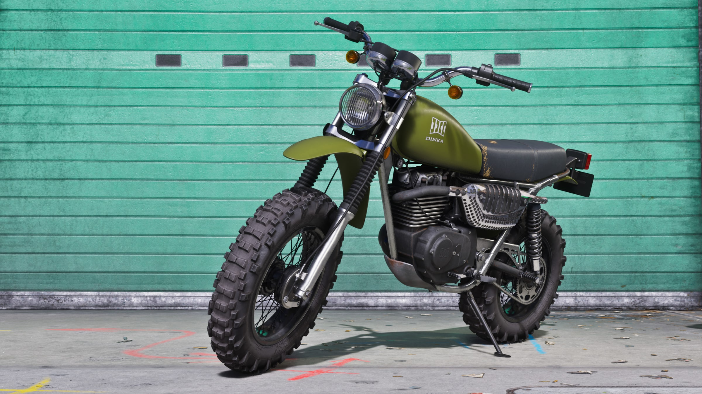

> **Información a 24 de octubre de 2026.** Las estadísticas se añadirán cuando salga el juego.

La Ultimate Edition añade dos vehículos al piso franco de Jason: una moto y un kayak.

## Dinka Enduro

| | |
|---|---|
| **Tipo** | Moto de campo (enduro) |
| **Marca** | Dinka |
| **Estilo** | Militar, en verde oliva |
| **Cómo conseguirla** | Incluida en la **Ultimate Edition** |

*Imagen: Rockstar Games*

## Crest Kayak

| | |
|---|---|
| **Tipo** | Kayak |
| **Marca** | Crest |
| **Cómo conseguirlo** | Incluido en la **Ultimate Edition** |

En *An Extended Look* ya se vio a los protagonistas remando en kayak, así que es un vehículo
que se puede usar en el juego.

*Imagen: Rockstar Games*

## Fuentes

- [Kotaku: todo lo que incluye la Ultimate Edition](https://kotaku.com/exclusive-vehicles-guns-and-more-heres-everything-included-in-the-grand-theft-auto-6-ultimate-edition-2000709941)
- [Rockstar Games: Media & Artwork](https://www.rockstargames.com/VI/media)
